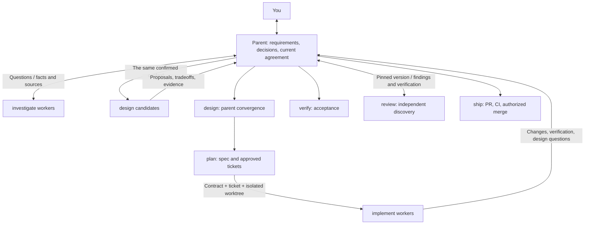

# Windflow

[English](README.md) | [简体中文](README.zh-CN.md)

**Agent Skills you can use individually or combine to deliver a change.**

Use `investigate` to understand code, `design` to compare approaches, and `review` to examine a PR. Each skill has its own entrypoint and required files. Use the optional `windflow` coordinator when you want to go from the first discussion to a PR ready to merge.

```text
Use investigate to trace save retries and explain why they need an idempotency key.
Use review to check this PR for duplicate writes. Return verified findings without changing code.
Use write to make this README useful to someone trying the project for the first time.
```

## Install the skills you need

```sh
npx skills@latest add YinFengWindy/windflow -g
```

Choose skills and your agent during installation. Omit `-g` for a project installation. To install from a local checkout, replace `YinFengWindy/windflow` with `.`.

For review alone:

```sh
npx skills@latest add YinFengWindy/windflow --skill review -g
```

The nine stage skills can each be installed independently. The complete `windflow` workflow needs the collection; installing its entrypoint alone does not install the other skills. It checks the skills needed by the current stage and reports missing ones.

These packages use Agent Skills. Select a skill through your host's entrypoint or say its name, such as "Use review". The installer needs Node.js/npm. Code and remote delivery operations also need Git and platform access. Independent candidates, parallel work, and independent review use the host's subagent capabilities.

## Choose a skill

| Your task | Skill | Result |
| --- | --- | --- |
| Understand current code and its history | [investigate](skills/investigate/SKILL.md) | Behavior chains, sources, constraints, and unknowns. |
| Settle a feature's behavior | [grill](skills/grill/SKILL.md) | Discussed and confirmed requirements. |
| Compare approaches and settle the structure | [design](skills/design/SKILL.md) | Compared proposals, then interfaces, types, and ownership. |
| Write a spec or break down work | [plan](skills/plan/SKILL.md) | A verifiable spec, tickets, and dependencies. |
| Implement agreed work | [implement](skills/implement/SKILL.md) | Code changes and focused check results. |
| Accept an existing result | [verify](skills/verify/SKILL.md) | Criteria met, unmet, or unverified, with evidence. |
| Find defects and examine proposed repairs | [review](skills/review/SKILL.md) | Confirmed defects, unanswered questions, and rejected suggestions. |
| Deliver implemented work | [ship](skills/ship/SKILL.md) | PR, CI, authorized merge, and cleanup results. |
| Explain technical work clearly | [write](skills/write/SKILL.md) | Documents or replies suited to the reader's task. |
| Coordinate a complete development task | [windflow](skills/windflow/SKILL.md) | The stages connected into a development workflow. |

Acceptance checks whether the promised behavior works. Review asks where current behavior can still fail. Acceptance reuses applicable implementation evidence; review findings are verified separately before they become repairs.

## A complete task

```text
Use windflow to add offline editing and automatic sync. Read the current save logic first, then help me decide how conflicts should work.
```

1. **Investigate, then discuss.** Investigators read save entrypoints, retry logic, and relevant history. The parent uses those facts to discuss competing offline edits with you. New factual questions return to investigators.
2. **Design after requirements are agreed.** The design skill obtains independent proposals, then the same parent that discussed the requirements compares them and settles interfaces, data structures, and ownership.
3. **Break the design into verifiable work.** Plan writes the spec, checks similar issues, and describes each ticket's behavior, acceptance criteria, and dependencies. You approve the breakdown before publication and implementation.
4. **Implement and accept the result.** Implementation agents work in isolated checkouts. The parent checks offline saving, sync after reconnecting, and the agreed conflict behavior, reusing valid check results.
5. **Review and deliver.** When review is needed, independent finders look for failures and each finding and repair direction is verified. You receive the actual PR, CI results, and remaining limitations before deciding to merge.

Discussion, planning, local edits, and review-only requests stop at the requested outcome. Existing requirements, designs, and approvals are reused while they remain applicable.

## How agents work together

The parent keeps the requirements and current decisions, talks with you, compares proposals, and settles the design. Separate skills do not require a new owner for every stage.



Workers receive current requirements, decision reasons, code baselines, and evidence they can revisit. Design contradictions return to the parent. The parent resolves technical adjustments and brings product changes to you. The coordinator's [communication rules](skills/windflow/references/coordination.md) describe the handoffs.

## Check review suggestions too

"A future caller might do this, so add a fallback" is not enough to justify a patch. A finding needs a current trigger, a failure mechanism, and an explanation of why existing protections do not prevent it. Verification also checks whether the proposed repair is necessary.

For example, a private function may already receive only validated IDs. Before adding a default, check whether a real caller bypasses validation. Even if one does, repairing that entrypoint may be more appropriate than manufacturing an ID inside the function. Unproven suggestions are reported separately instead of becoming patches.

The complete method is inside [review](skills/review/SKILL.md), which can be installed on its own.

## Sources and integration

Upstream methods are integrated into skills with defined responsibilities:

| Windflow | Upstream methods |
| --- | --- |
| `investigate` | pstack: `how`, `why` |
| `grill` | Matt Pocock: `grilling` |
| `design` | pstack: `arena`, `architect` |
| `write` | pstack: `unslop`, `technical-writing` |
| Agent coordination | pstack: `swarm` |

Plan, implement, verify, review, and ship follow this project's stage responsibilities. Plan retains specification and slicing ideas previously adapted from `to-spec` and `to-tickets`; Windflow defines the workflow and approval rules.

See [Matt Pocock's skills](https://github.com/mattpocock/skills) and [Lauren Tan's pstack](https://github.com/cursor/plugins/tree/main/pstack). Revisions and adaptations are recorded centrally in the [source notices](THIRD_PARTY_NOTICES.md) and [version lock](upstream-lock.json). Each skill retains its license file.

MIT. See [LICENSE](LICENSE).
