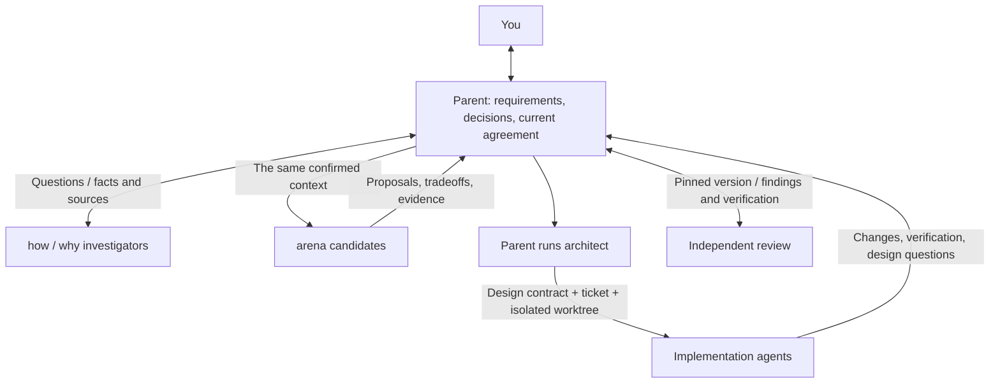
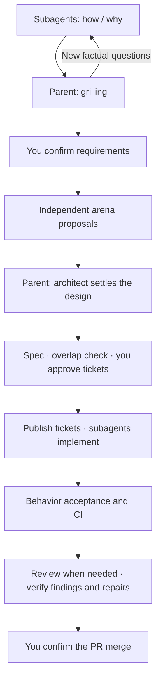

# Windflow

[English](README.md) | [简体中文](README.zh-CN.md)

**Give your agent a task. Work through it together, from the first discussion to a PR ready to merge.**

Windflow is a development workflow skill for coding agents that support Agent Skills. It starts by reading the code and relevant history, works with you to settle the behavior, then compares designs, implements the change, and checks the result. You decide the requirements, ticket breakdown, and final merge. The agent carries the work between those decisions.

```text
Use windflow to add offline editing and automatic sync. Read the current save logic first, then help me decide how conflicts should work.
```

Start everyday work with "Use windflow". Investigation, discussion, design, and implementation continue in the same task.

## Install, then describe your task

```sh
npx skills@latest add YinFengWindy/windflow --skill windflow -g
```

Choose your agent during installation. Start a new session in your project, select Windflow through your tool's skill entrypoint, or say "Use windflow" followed by your task. Omit `-g` for a project installation. To install from a local checkout, replace `YinFengWindy/windflow` with `.`.

You need Node.js/npm and Git. Issues, PRs, and remote CI also need access to the relevant platform. The full workflow uses the host's subagent capabilities; see [agent communication](skills/windflow/references/delegation.md) for requirements and handling when a capability is unavailable.

## What happens after that first prompt

Take the offline editing and sync request above:

1. **Read the project.** Investigation agents find the save entrypoints, retry behavior, and relevant design history. They return facts, sources, and unanswered questions.
2. **Discuss the choices with you.** Suppose local saving already works. The parent can ask, "What should happen when two devices edit the same document offline?" If an answer depends on existing code, it investigates that first.
3. **Compare designs once you agree on the behavior.** Independent `arena` agents propose solutions to the same requirement. The parent compares their tradeoffs, then uses `architect` to settle interfaces, data structures, and state ownership.
4. **Break the design into work you can accept.** You see what each ticket delivers, how to check it, and what it depends on. Tickets are published and implementation starts after you approve the breakdown.
5. **Implement and check the behavior.** Implementers work in isolated checkouts and verify offline saves, sync after reconnecting, and your chosen conflict behavior. The parent inspects the changes, acceptance evidence, and CI results.
6. **Bring you the finished PR.** Changes that need review go through independent defect discovery and finding verification. You see what changed, what was checked, and what remains uncertain before deciding whether to merge.

You keep talking to the same parent agent. Each worker receives the confirmed requirements, reasons for decisions, and source evidence it can revisit. If the design does not hold up, the worker brings that evidence back to the parent.

## How the agents work together

The parent keeps the requirements and current decisions, talks with you, compares proposals, and settles the design. Workers receive the same confirmed context and return their investigation, implementation, or review results.



## Why the workflow works this way

### Read the project before interviewing you

"How does this system save data today?" is a question the agent should answer from the code. "Which edit should survive a conflict?" is a choice for you. New factual questions go back to investigators as the discussion develops.

### Compare designs before committing to one

The first workable approach may be expensive to maintain. Windflow gets independent proposals, then lets the parent that discussed the requirement with you choose and develop the design. If implementation exposes a contradiction, the worker must explain which assumption failed rather than quietly change the feature.

### Check the review comments too

"A future caller might do this, so add a fallback" is not enough to justify a patch. A finding needs a current trigger, a failure mechanism, and an explanation of why existing protections do not prevent it. Verification checks those claims and whether the proposed repair is necessary.

For example, a private function may already receive only validated IDs. Before adding a default value, the verifier checks for a real caller that bypasses validation. Even if one exists, fixing that entrypoint may be more appropriate than manufacturing an ID inside the function. Unproven suggestions are reported separately instead of becoming patches.

## Prompts to start with

**A feature whose details are still open:**

```text
Use windflow to let users save a set of search filters and reuse it later. Read the existing search and settings code before we discuss the behavior.
```

**A bug you have already seen:**

```text
Use windflow: clicking Save twice creates duplicate records. Reproduce it, find the cause, then fix and verify it.
```

**Work already specified in an issue:**

```text
Use windflow to implement issue #42 using its approved requirements and design.
```

**A review without code changes:**

```text
Use windflow to review this PR for duplicate writes during retries. Return verified findings. Do not change code.
```

**An idea you only want to discuss:**

```text
Use windflow. I want settings to sync across devices. Discuss the requirements with me; do not create issues or implement anything yet.
```

Existing requirements, designs, and approvals are reused. A localized change starts at the stage it needs. Discussion, planning, local edits, and review-only requests stop at the outcome you specify.

## When you make a decision

| Checkpoint | What you receive |
| --- | --- |
| Requirements | Intended behavior, acceptance criteria, scope, and material tradeoffs. |
| Ticket breakdown | The tickets, what each delivers, how it is checked, and its dependencies. |
| Merge | The actual PR, check results, review findings or exemption, and remaining limitations. |

The agent checks for similar issues once after drafting the spec. If work overlaps, you choose whether to reuse, extend, or create a separate issue.

## Full workflow and included methods



| Method | What it does in the workflow |
| --- | --- |
| [how](skills/windflow/skills/how/SKILL.md) / [why](skills/windflow/skills/why/SKILL.md) | Trace current behavior and the reasons behind the design. |
| [grilling](skills/windflow/skills/grilling/SKILL.md) | Work through unresolved product decisions with you. |
| [arena](skills/windflow/skills/arena/SKILL.md) | Produce independent solutions to the same requirement. |
| [architect](skills/windflow/skills/architect/SKILL.md) | Let the parent turn the chosen proposal into a design. |
| [swarm](skills/windflow/skills/swarm/SKILL.md) | Divide independent investigation or implementation work. |
| [unslop](skills/windflow/skills/unslop/SKILL.md) / [technical-writing](skills/windflow/skills/technical-writing/SKILL.md) | Write clear replies, specs, design explanations, and PRs. |

See the [skill entrypoint](skills/windflow/SKILL.md), [agent communication](skills/windflow/references/delegation.md), [review procedure](skills/windflow/references/review.md), and [delivery rules](skills/windflow/references/delivery.md) for the detailed instructions.

## Sources

Windflow adapts the following skills:

- [Matt Pocock's skills](https://github.com/mattpocock/skills): `grilling`.
- [Lauren Tan's pstack](https://github.com/cursor/plugins/tree/main/pstack): `how`, `why`, `arena`, `architect`, `swarm`, `unslop`, and `technical-writing`.

See the [source notices](skills/windflow/THIRD_PARTY_NOTICES.md) and [version lock](skills/windflow/upstream-lock.json) for revisions and adaptations.

MIT. See [LICENSE](LICENSE) and [third-party notices](THIRD_PARTY_NOTICES.md).
