# Windflow

[English](README.md) | [简体中文](README.zh-CN.md)

Windflow helps a coding agent understand a system, agree on the intended behavior, compare designs, and deliver changes with evidence.

The parent agent keeps the requirements and design in context. Subagents investigate, propose alternatives, implement scoped work, and look for defects. You confirm the requirements, ticket breakdown, and finished PR before merge.

## How work moves

```mermaid
flowchart LR
  H["Subagents: how / why"] --> G["Parent: grilling"]
  G -->|New factual questions| H
  G --> C["You confirm requirements"]
  C --> A["Independent arena proposals"]
  A --> D["Parent: architect"]
  D --> T["Spec and approved tickets"]
  T --> I["Implementation agents"]
  I --> V["Acceptance and CI"]
  V --> R["Review when required"]
  R --> M["You confirm merge"]
```



Investigation comes before the interview. The parent reads the evidence and asks you about product choices. New factual questions go back to investigators until the behavior and scope are settled.

Arena candidates work independently from the same confirmed context. The parent compares their proposals, then runs architect to settle interfaces, types, state ownership, and constraints. Architect uses arena's result rather than starting another competition.

The parent drafts the spec and ticket breakdown. It checks similar issues once after the spec draft and asks you to resolve plausible overlaps. It publishes tickets and starts their implementation after you approve the breakdown.

Existing requirements, designs, tickets, and approvals are reused when they still apply. A request to discuss, plan, edit locally, or review stops at that outcome.

## Keep context across agents

Workers receive the current requirements, decision reasons, source evidence, constraints, unknowns, and code baseline. Conversation inheritance can help, but it does not replace accessible source evidence or a clearly identified current decision.

Questions return to the parent. Implementers report design contradictions instead of silently changing the contract. The parent resolves technical details, brings material product changes to you, and updates affected workers.

Each writer has an isolated workspace. The parent inspects the actual diff and verification evidence before integrating. See [agent communication](skills/windflow/references/delegation.md).

## Review changes that need review

Acceptance checks whether the promised behavior works. Review looks for failures elsewhere in the affected behavior chains.

Independent finders report a reachable trigger, a causal path, the broken constraint, and evidence. A separate verification step checks existing protections and counterevidence. It also asks whether the proposed repair is necessary. An imagined future caller does not justify a new guard, retry, fallback, compatibility layer, or abstraction.

Confirmed defects, unanswered factual questions, rejected findings, and future suggestions stay distinct. There is no finding quota or universal reviewer count. See the [review procedure](skills/windflow/references/review.md).

Small bounded features and UI-only changes retain the automatic-review exemptions. Explicit review requests run. Shared contracts, broad refactors, and substantive changes to permissions, authentication, billing, persistence, or deletion require review. Exemptions do not skip acceptance, CI, provider approvals, or your merge confirmation.

Local validation focuses on changed behavior and affected callers. Passing checks are reused unless relevant changes or evidence gaps require another run. Required external CI stays in place.

## Install

Requires a host that reads skills, Git, and authenticated tracker access for remote delivery. Native subagents support independent proposals, implementation, and review. Capability limits are reported when the host cannot perform a stage.

```sh
npx skills@latest add YinFengWindy/windflow --skill windflow --agent codex -g
```

For a project installation, omit `-g`. Install the parent `windflow` skill so its eight companions, references, and licenses stay together. The package loads companions by relative path; it does not depend on separately installed skills with the same names.

From a local checkout, replace `YinFengWindy/windflow` with `.`. When migrating from the former `dev-flow` name, preserve any local customizations and remove or archive the old entry after verifying the new installation. Start a new session to refresh discovery.

## Use it

```text
$windflow Add saved searches. Investigate the existing behavior before we discuss the requirement.
$windflow Implement issue #42 using its approved requirements and design.
$windflow Continue this PR through its remaining checks.
$windflow Draft a spec only; do not publish or implement.
$windflow Review this branch without changing code.
```

The parent handles authorized Git and tracker actions between confirmations. It shows the concrete PR and evidence before asking to merge, verifies the actual merge, and cleans up eligible source branches. Read the [delivery rules](skills/windflow/references/delivery.md) for resuming CI, review, merge, and cleanup.

## Included methods

| Capability | Purpose |
| --- | --- |
| [how](skills/windflow/skills/how/SKILL.md) / [why](skills/windflow/skills/why/SKILL.md) | Current behavior and historical constraints. |
| [grilling](skills/windflow/skills/grilling/SKILL.md) | Product decisions through an informed interview. |
| [arena](skills/windflow/skills/arena/SKILL.md) | Independent alternatives and a reasoned synthesis. |
| [architect](skills/windflow/skills/architect/SKILL.md) | Parent-led design convergence. |
| [swarm](skills/windflow/skills/swarm/SKILL.md) | Bounded parallel work and integration. |
| [unslop](skills/windflow/skills/unslop/SKILL.md) / [technical-writing](skills/windflow/skills/technical-writing/SKILL.md) | Clear replies, specifications, and delivery records. |

Windflow adapts grilling from Matt Pocock and seven methods from Lauren Tan's pstack. Its planning, agent coordination, review, and delivery policies follow the owner's workflow. Source revisions and adaptations are recorded in [third-party notices](skills/windflow/THIRD_PARTY_NOTICES.md) and the [upstream lock](skills/windflow/upstream-lock.json).

## Maintain the package

Run `npm run check` to validate packaging and internal links. The focused packaging tests are in `scripts/check-bundle.test.mjs`; CI runs them on Windows and Linux.

Skill instructions guide the agent. They do not install repository protection, create a scheduler, or prove that an agent followed every step. Validate behavior in real tasks as well as package structure.

MIT. See [LICENSE](LICENSE) and [third-party notices](THIRD_PARTY_NOTICES.md).
