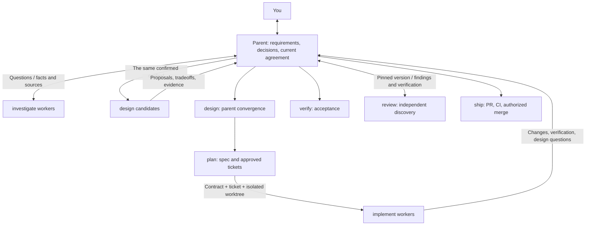

# Windflow

[English](README.md) | [简体中文](README.zh-CN.md)

**Agent Skills you can use individually or combine to deliver a change.**

Use `investigate` to understand code, `design` to compare approaches, and `review` to examine a PR. Use the optional `windflow` coordinator when you want to go from the first discussion to a PR ready to merge.

```text
Use investigate to trace save retries and explain why they need an idempotency key.
Use review to check this PR for duplicate writes. Return verified findings without changing code.
Use write to make this README useful to someone trying the project for the first time.
```

## Install the skills you need

```sh
npx skills@latest add YinFengWindy/windflow -g
```

Choose skills and your agent during installation. Omit `-g` for a project installation. To install from a local checkout, replace `YinFengWindy/windflow` with `.`.

For review alone:

```sh
npx skills@latest add YinFengWindy/windflow --skill review -g
```

The nine stage skills install independently. Installing the `windflow` entrypoint alone does not install the others. Hosts discover a skill by its name and description. The coordinator's instructions check the skills the current stage needs and report any that are missing; installer metadata does not do that check.

Select a skill through your host's entrypoint, or say its name, such as "Use review". The installer needs Node.js and npm. Code and remote delivery also need Git and access to the repository host. Independent candidates, parallel work, and independent review use the host's subagents.

## Choose a skill

| Your task | Skill | Result |
| --- | --- | --- |
| Understand current code and its history | [investigate](skills/investigate/SKILL.md) | Behavior chains, sources, constraints, and unknowns. |
| Settle a feature's behavior | [grill](skills/grill/SKILL.md) | Discussed and confirmed requirements. |
| Compare approaches and settle the structure | [design](skills/design/SKILL.md) | Compared proposals, then interfaces, types, and ownership. |
| Write a spec or break down work | [plan](skills/plan/SKILL.md) | A verifiable spec, tickets, and dependencies. |
| Implement agreed work | [implement](skills/implement/SKILL.md) | Code changes and focused check results. |
| Accept an existing result | [verify](skills/verify/SKILL.md) | Criteria met, unmet, or unverified, with evidence. |
| Find defects and examine proposed repairs | [review](skills/review/SKILL.md) | Confirmed defects, unanswered questions, and rejected suggestions. |
| Deliver implemented work | [ship](skills/ship/SKILL.md) | PR, CI, authorized merge, and cleanup results. |
| Explain technical work clearly | [write](skills/write/SKILL.md) | Documents or replies suited to the reader's task. |
| Coordinate a complete development task | [windflow](skills/windflow/SKILL.md) | The stages connected into a development workflow. |

Acceptance, review, and merge approval are separate gates. The [coordinator](skills/windflow/SKILL.md) states each one once.

## A complete task

```text
Use windflow to add offline editing and automatic sync. Read the current save logic first, then help me decide how conflicts should work.
```

1. **Investigate, then discuss.** Investigators read save entrypoints, retry logic, and relevant history. The parent uses those facts to discuss competing offline edits with you. New factual questions return to investigators.
2. **Design after requirements are agreed.** The design skill obtains independent proposals, then the same parent that discussed the requirements compares them and settles interfaces, data structures, and ownership.
3. **Break the design into verifiable work.** Plan writes the spec, checks similar issues, and describes each ticket's behavior, acceptance criteria, and dependencies. You approve the breakdown before publication and implementation.
4. **Implement and accept the result.** Implementation agents work in isolated checkouts. The parent checks offline saving, sync after reconnecting, and the agreed conflict behavior, reusing valid check results.
5. **Review and deliver.** When review is needed, independent finders look for failures, and each finding and repair direction is verified. You receive the actual PR, CI results, and remaining limitations before deciding to merge.

A request to discuss, plan, edit locally, or only review stops at that result. Requirements, designs, and approvals that still apply are reused.

## How agents work together

The parent keeps the current agreement and talks with you. Workers return evidence. Handoffs are in the coordinator's [communication rules](skills/windflow/references/coordination.md).



## Check a review suggestion

"A future caller might do this, so add a fallback" is not a reason to patch. A finding needs a current trigger, the failure mechanism, and a reason the existing protections do not prevent it. The method is [review](skills/review/SKILL.md), which can be installed on its own.

## Sources and integration

| Windflow | Upstream methods |
| --- | --- |
| `investigate` | pstack: `how`, `why` |
| `grill` | Matt Pocock: `grilling` |
| `design` | pstack: `arena`, `architect` |
| `write` | pstack: `unslop`, `technical-writing` |
| Agent coordination | pstack: `swarm` |

See [Matt Pocock's skills](https://github.com/mattpocock/skills) and [Lauren Tan's pstack](https://github.com/cursor/plugins/tree/main/pstack). Revisions, adaptations, and third-party copyright notices are in [THIRD_PARTY_NOTICES](THIRD_PARTY_NOTICES.md) and the [version lock](upstream-lock.json).

MIT. The repository license is [LICENSE](LICENSE).
