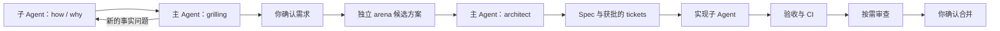

# Windflow

[English](README.md) | [简体中文](README.zh-CN.md)

Windflow 帮助编程 Agent 理解系统、确认需求、比较设计，并用证据交付改动。

主 Agent 持续掌握需求和设计上下文。子 Agent 负责调查、提出候选方案、实现具体工作和寻找缺陷。你在需求确认、ticket 拆分和最终 PR 合并时作决定。

## 工作怎样推进



调查先于访谈。主 Agent 消化证据，再与你讨论产品选择。访谈中出现新的事实问题，就交回调查者，直到行为和范围达成一致。

Arena 候选者基于同一份已确认上下文独立提出方案。主 Agent 比较方案，再执行 architect，确定接口、类型、状态归属和约束。Architect 承接 arena 的结果，避免重复启动方案竞赛。

主 Agent 整理 Spec 和 ticket 拆分。Spec 草稿后只查重一次；发现可能重叠的 issue 时，由你决定如何处理。拆分获得确认后，才发布 tickets 并开始对应实现。

已有需求、设计、ticket 和确认仍然适用时直接复用。只讨论、只规划、本地修改或只审查的请求，停在指定结果。

## Agent 怎样共享上下文

工作者获得当前需求、决策原因、源码证据、约束、未知项和代码基线。继承对话可以补充上下文，但仍需提供可回查的依据，并明确哪一版决定有效。

问题交回主 Agent。实现者发现设计矛盾时，报告证据，不静默改变约定。主 Agent 处理技术调整，将实质性产品变化交给你，并把更新后的决定传给受影响的工作者。

每个写入者使用隔离工作区。主 Agent 检查实际 diff 和验证证据，再集成结果。详见[代理协作规则](skills/windflow/references/delegation.md)。

## 审查关注成立的缺陷和必要的修复

验收检查承诺的行为是否实现。审查检查改动还会在哪些现有行为链路中引发失败。

独立审查者需要说明可达的触发条件、因果链、被破坏的约束和证据。核验环节检查已有保护和反证，也检查建议的修复是否必要。想象一个未来调用者，不足以要求增加 guard、重试、fallback、兼容层或抽象。

已确认缺陷、待核验问题、已排除发现和未来设计建议分别记录。没有发现数量指标，也不预设所有项目都使用相同数量的 reviewer。详见[审查方法](skills/windflow/references/review.md)。

小范围功能改动和纯 UI 改动沿用自动审查豁免；用户明确要求审查时执行。共享契约、广泛重构，以及权限、认证、计费、持久化或删除语义的实质性改动需要审查。豁免不跳过验收、CI、平台审批或你的合并确认。

本地验证覆盖改动行为和受影响的调用者。已经通过的检查会复用，只有相关改动或证据缺口才需要重跑。外部要求的 CI 保持有效。

## 安装

运行环境需要支持 skills；远程交付需要 Git 和已认证的 tracker。原生子 Agent 用于独立方案、实现和审查。环境不支持某个环节时，Agent 会说明能力限制。

```sh
npx skills@latest add YinFengWindy/windflow --skill windflow --agent codex -g
```

仅安装到当前项目时去掉 `-g`。安装父级 `windflow`，让八个配套能力、参考文件和许可证一起保留。包内能力通过相对路径读取，无需另装同名全局 skill。

从本地仓库安装时，将命令中的 `YinFengWindy/windflow` 替换为 `.`。从旧名称 `dev-flow` 迁移时，先保留本地定制，确认新安装有效后再移除或归档旧入口。新建会话以刷新发现结果。

## 使用

```text
$windflow 增加保存搜索条件的功能，先调查现有行为，再和我讨论需求。
$windflow 按已经确认的需求和设计实现 issue #42。
$windflow 继续当前 PR，完成剩余检查。
$windflow 只整理 Spec，不发布，也不实现。
$windflow 只审查当前分支，不改代码。
```

确认点之间，主 Agent 处理已授权的 Git 和 tracker 操作。它先呈现具体 PR 和证据，请你确认合并，再核实实际合并结果、清理符合条件的来源分支。CI、审查、合并和恢复规则见[交付说明](skills/windflow/references/delivery.md)。

## 包含的方法

| 能力 | 用途 |
| --- | --- |
| [how](skills/windflow/skills/how/SKILL.md) / [why](skills/windflow/skills/why/SKILL.md) | 调查当前行为和历史约束。 |
| [grilling](skills/windflow/skills/grilling/SKILL.md) | 在充分上下文基础上讨论产品选择。 |
| [arena](skills/windflow/skills/arena/SKILL.md) | 比较独立候选方案并形成选择。 |
| [architect](skills/windflow/skills/architect/SKILL.md) | 由主 Agent 收敛设计。 |
| [swarm](skills/windflow/skills/swarm/SKILL.md) | 分派有边界的并行工作，集成结果。 |
| [unslop](skills/windflow/skills/unslop/SKILL.md) / [technical-writing](skills/windflow/skills/technical-writing/SKILL.md) | 写清讨论、规格和交付记录。 |

Windflow 适配了 Matt Pocock 的 grilling 和 Lauren Tan 的七个 pstack 方法。规划、代理协作、审查和交付规则遵循使用者确认的流程。版本与适配记录见[第三方来源声明](skills/windflow/THIRD_PARTY_NOTICES.md)和[版本锁定](skills/windflow/upstream-lock.json)。

## 维护

运行 `npm run check` 检查包结构和内部链接。安装包的定向测试位于 `scripts/check-bundle.test.mjs`，CI 在 Windows 和 Linux 上执行。

Skill 指令指导 Agent 行为，不会安装仓库保护或创建后台调度器，也不能证明 Agent 始终遵守流程。除了检查包结构，还需要通过实际任务验证行为。

MIT，见 [LICENSE](LICENSE) 和[第三方声明](THIRD_PARTY_NOTICES.md)。
