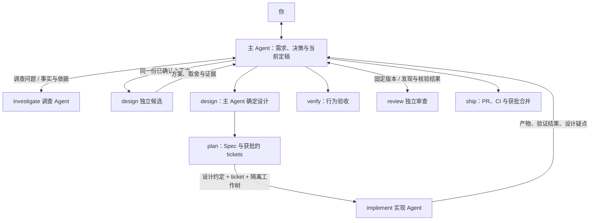

# Windflow

[English](README.md) | [简体中文](README.zh-CN.md)

**一组可以单独使用，也可以串起来完成开发的 Agent Skills。**

想读懂代码，用 `investigate`；想比较设计，用 `design`；想审查 PR，用 `review`。每个 skill 都有自己的入口和所需文件。需要从讨论一直推进到可合并的 PR 时，再用 `windflow` 编排完整流程。

```text
使用 investigate，看看保存请求失败后会怎样重试，为什么这里需要幂等键。
使用 review，审查这个 PR 是否会重复写入，先给出核验后的发现，不改代码。
使用 write，把这份 README 改成第一次使用的人能照着操作的介绍。
```

## 安装你需要的 skills

```sh
npx skills@latest add YinFengWindy/windflow -g
```

安装时选择 skills 和你使用的 Agent。仅安装到当前项目时，去掉 `-g`。从本地 checkout 安装时，将 `YinFengWindy/windflow` 换成 `.`。

只需要审查，可以单独安装：

```sh
npx skills@latest add YinFengWindy/windflow --skill review -g
```

九个阶段技能都可以独立安装。完整的 `windflow` 流程需要安装整套；只安装总入口不会自动带上其他 skills。它会检查当前阶段需要的技能，并明确报告缺失项。

这些技能按 Agent Skills 格式分发。通过运行环境的技能入口选择，或直接说“使用 review”等名称。需要 Node.js/npm 运行安装命令；代码与远程交付操作还需要 Git 和对应平台的权限。独立候选、并行工作和独立审查使用运行环境提供的子 Agent。

## 选哪个 skill

| 你要做什么 | Skill | 会得到什么 |
| --- | --- | --- |
| 看懂当前代码和历史原因 | [investigate](skills/investigate/SKILL.md) | 行为链路、依据、约束和未知项。 |
| 把功能想清楚 | [grill](skills/grill/SKILL.md) | 经过讨论和确认的需求。 |
| 比较做法，再确定结构 | [design](skills/design/SKILL.md) | 候选方案比较，以及最终接口、类型和状态归属。 |
| 写 Spec 或拆任务 | [plan](skills/plan/SKILL.md) | 可验收的 Spec、tickets 和依赖关系。 |
| 实现明确的工作 | [implement](skills/implement/SKILL.md) | 代码改动和针对性检查结果。 |
| 验收已有结果 | [verify](skills/verify/SKILL.md) | 每项标准是否满足，以及证据和缺口。 |
| 找缺陷并核验建议 | [review](skills/review/SKILL.md) | 已确认缺陷、待核验问题和被排除的建议。 |
| 把已完成的改动交付 | [ship](skills/ship/SKILL.md) | PR、CI、获批合并和清理结果。 |
| 写清楚技术内容 | [write](skills/write/SKILL.md) | 适合读者任务的文档、说明或回复。 |
| 完整推进一个开发任务 | [windflow](skills/windflow/SKILL.md) | 上述阶段衔接起来的开发流程。 |

验收看“承诺的行为是否实现”；审查看“当前哪些路径还会失败”。实现者的检查结果可以供验收复用，审查意见则需要单独核验，不能因为有人提出就直接改代码。

## 一个完整任务会怎样推进

```text
使用 windflow，我想加离线编辑和自动同步。先看看现在的保存逻辑，再和我讨论冲突怎么处理。
```

1. **调查，再讨论。** 调查者读取保存入口、重试逻辑和历史记录。主 Agent 消化事实后，问你两台设备离线修改同一文档时该怎样处理冲突。新事实问题继续交给调查者。
2. **确认需求后设计。** `design` 先让独立候选者提出方案，再由一直参与需求讨论的主 Agent 比较和确定接口、数据结构及状态归属。
3. **把方案拆成能验收的工作。** `plan` 整理 Spec、检查相似 issue，并列出每个 ticket 的行为、验收条件和依赖。你确认拆分后才发布和实现。
4. **实现并验收。** 实现子 Agent 在隔离工作区修改代码。主 Agent 核对离线保存、恢复网络后的同步和已确认的冲突处理，复用有效的检查结果。
5. **审查，再交付。** 需要审查时，由独立审查者寻找失败路径，再逐条核验发现和修复必要性。完成后呈现实际 PR、CI 和剩余限制，请你决定是否合并。

只讨论、只规划、本地修改或只审查的请求，停在指定结果。已有需求、设计和确认仍然有效时，会直接复用。

## Agent 怎样协作

主 Agent 保留需求和当前决定，负责与你沟通、比较方案和确定设计。拆分 skill 不会让每个阶段都换一个负责人。



工作者拿到当前需求、决策原因、代码基线和可回查的依据。发现设计矛盾时，带着证据交回主 Agent；技术调整由主 Agent 处理，产品变化再与你讨论。详细约定在总入口的[协作规则](skills/windflow/references/coordination.md)里。

## 审查意见也需要被检查

“未来可能有人这样调用，所以加一层兜底”不足以成为修改理由。审查要解释当前哪里能触发、怎样出错、已有保护为什么无效。核验还会检查建议的修复是否必要。

例如，内部函数已经只接收校验过的 ID，审查者建议加默认值。核验首先检查是否有真实调用路径绕过校验；即使有，也要判断修复入口是否比在内部伪造 ID 更合适。无法证实的建议会单独说明，不直接变成补丁。

这套方法完整地放在 [review](skills/review/SKILL.md) 内，单独安装即可使用。

## 来源与融合

上游方法被融合进各自负责的 Windflow skill：

| Windflow | 上游方法 |
| --- | --- |
| `investigate` | pstack：`how`、`why` |
| `grill` | Matt Pocock：`grilling` |
| `design` | pstack：`arena`、`architect` |
| `write` | pstack：`unslop`、`technical-writing` |
| 代理协作规则 | pstack：`swarm` |

`plan`、`implement`、`verify`、`review`、`ship` 按本项目的阶段职责编写。`plan` 保留了先前适配的 `to-spec`、`to-tickets` 中的规格和切片方法，流程和确认规则由 Windflow 定义。

参考 [Matt Pocock 的 skills](https://github.com/mattpocock/skills) 和 [Lauren Tan 的 pstack](https://github.com/cursor/plugins/tree/main/pstack)。具体版本与适配范围统一记录在[来源声明](THIRD_PARTY_NOTICES.md)和[版本锁定](upstream-lock.json)中；各 skill 保留自己的许可证文件。

MIT，见 [LICENSE](LICENSE)。
