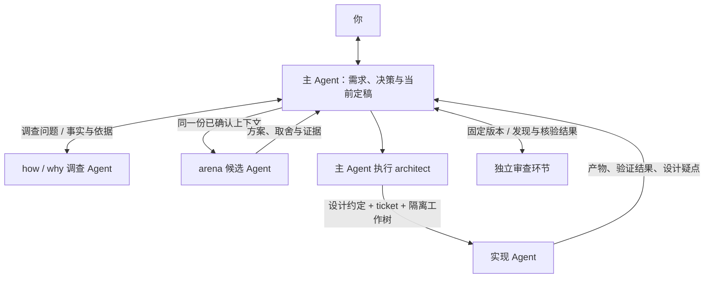
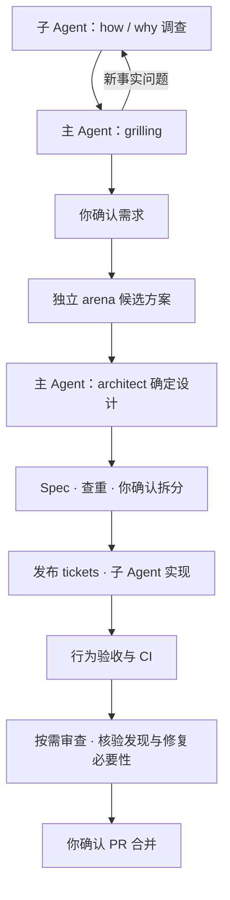

# Windflow

[English](README.md) | [简体中文](README.zh-CN.md)

**给 Agent 一个需求，从讨论做到可合并的 PR。**

Windflow 是一套面向编程 Agent 的开发流程 skill。它先读代码和相关历史，与你确认要做的行为，再比较方案、实现功能、验证结果。你负责需求、任务拆分和最终合并这几个决定，Agent 负责把中间的工作推进下去。

```text
使用 windflow，我想加离线编辑和自动同步。先看看现在的保存逻辑，再和我讨论冲突怎么处理。
```

日常从“使用 windflow”开始。调查、访谈、方案比较和实现会在同一个任务里衔接起来。

## 安装，然后说你要做什么

```sh
npx skills@latest add YinFengWindy/windflow --skill windflow -g
```

它按 Agent Skills 格式分发，安装时选择你使用的 Agent。然后在项目里新建会话，通过工具的技能入口选择 Windflow，或直接说“使用 windflow”并描述任务。仅为当前项目安装时，去掉 `-g`；从本地 checkout 安装时，将 `YinFengWindy/windflow` 换成 `.`。

需要 Node.js/npm 和 Git。创建 issue、PR 或运行远程 CI 时，还需要对应平台的访问权限。完整流程使用运行环境提供的子 Agent 能力；具体要求与能力不足时的处理方式见[代理协作规则](skills/windflow/references/delegation.md)。

## 一句话进去，后面会发生什么

以上面的“离线编辑和自动同步”为例：

1. **先查项目。** 调查 Agent 找到保存入口、重试逻辑和相关设计记录，把事实、出处和未知项交给主 Agent。
2. **带着上下文和你讨论。** 假设项目已经支持本地保存，主 Agent 会接着问：“两台设备离线修改同一份文档，冲突时怎么处理？”如果问题取决于现有代码，它会先补查，再继续讨论。
3. **确认需求后比较方案。** 独立的 `arena` 子 Agent 基于同一份需求提出方案。主 Agent 比较取舍，再通过 `architect` 确定接口、数据结构和状态归属。
4. **把方案拆成能验收的任务。** 你会看到每个 ticket 要完成什么、怎样算完成，以及依赖哪些工作。确认拆分后，才发布 tickets 并开始实现。
5. **实现并验证。** 实现者在隔离工作区修改代码，检查离线保存、恢复网络后的同步，以及你确认的冲突行为。主 Agent 核对实际改动、验证结果和 CI。
6. **把完成的 PR 交给你。** 需要审查的改动先完成独立找错和逐条核验。你看到改动说明、验收结果和剩余限制，再决定是否合并。

你始终和同一个主 Agent 讨论。子 Agent 接手时会拿到已确认的需求、决策原因和可回查的源码依据；发现设计不成立，会带着证据交回主 Agent 处理。

## Agent 怎样协作

主 Agent 保留需求和当前决定，负责与你沟通、比较方案和确定设计。子 Agent 获得同一份已确认上下文，并把调查、实现或审查结果交回主 Agent。



## 为什么这样安排

### 先读懂项目，再问你问题

“这个系统现在怎么保存数据”应该由 Agent 查代码回答。“冲突时保留哪份数据”才需要你决定。访谈中的新事实问题会继续交给调查者，直到需求确认。

### 在写代码前比较方案

第一个能想到的方案不一定值得维护。Windflow 先让独立候选者提出完整方案，再由一直参与需求讨论的主 Agent 选择和整理设计。实现者发现设计矛盾时，需要说明哪个前提不成立，不能悄悄改变功能行为。

### 审查意见也需要被检查

“以后可能有人这样调用，所以再加一层兜底”不足以成为修改理由。审查要说明当前哪里能触发、怎样出错、已有保护为什么无效。核验者再检查这些判断，以及建议的修复是否必要。

例如，一个内部函数已经只接收入口校验过的 ID，审查者建议再补默认值。核验首先检查是否真有调用路径绕过校验；即使有，也要判断修复入口是否比在内部伪造一个 ID 更合适。无法证实的建议会单独说明，不直接变成补丁。

## 常用开场白

**加一个功能，还没想清细节：**

```text
使用 windflow，我想让用户保存一组搜索条件，下次直接使用。先调查现有搜索和设置功能，再和我讨论。
```

**修一个已经遇到的 Bug：**

```text
使用 windflow：连续点两次保存会产生重复记录。先复现，找到原因，再修复并验证。
```

**需求已经在 issue 里：**

```text
使用 windflow 实现 issue #42，沿用里面确认的需求和设计。
```

**只想检查代码：**

```text
使用 windflow 审查这个 PR，重点看看重试是否会重复写入。先给出核验后的发现，不改代码。
```

**先把想法讨论清楚：**

```text
使用 windflow，我想把设置同步到多台设备。这次只讨论需求，不创建 issue，也不实现。
```

已有的需求、设计和确认会被复用。局部修改从需要的阶段开始；你指定只讨论、只规划、本地修改或只审查时，流程就停在那里。

## 你在什么时候作决定

| 确认点 | 你会看到什么 |
| --- | --- |
| 需求确认 | 要实现的行为、验收标准、范围和重要取舍。 |
| 拆分确认 | Ticket 列表、每项交付内容、验收条件和依赖关系。 |
| 合并确认 | 实际 PR、检查结果、审查结论或豁免原因，以及剩余限制。 |

Spec 草稿完成后会查一次相似 issue。发现可能重叠的工作时，会先请你决定复用、补充还是单独创建。

## 完整流程和能力分工



| 能力 | 在流程中做什么 |
| --- | --- |
| [how](skills/windflow/skills/how/SKILL.md) / [why](skills/windflow/skills/why/SKILL.md) | 查现在如何运行，以及为什么这样设计。 |
| [grilling](skills/windflow/skills/grilling/SKILL.md) | 和你逐轮讨论尚未决定的产品问题。 |
| [arena](skills/windflow/skills/arena/SKILL.md) | 为同一个需求提出独立候选方案。 |
| [architect](skills/windflow/skills/architect/SKILL.md) | 由主 Agent 把选定方案落实成设计。 |
| [swarm](skills/windflow/skills/swarm/SKILL.md) | 并行分派可以独立完成的调查或实现工作。 |
| [unslop](skills/windflow/skills/unslop/SKILL.md) / [technical-writing](skills/windflow/skills/technical-writing/SKILL.md) | 写清讨论、Spec、设计说明和 PR。 |

具体规则见[技能入口](skills/windflow/SKILL.md)、[代理协作](skills/windflow/references/delegation.md)、[审查方法](skills/windflow/references/review.md)和[交付说明](skills/windflow/references/delivery.md)。

## 来源

Windflow 适配了以下 skills：

- [Matt Pocock 的 skills](https://github.com/mattpocock/skills)：`grilling`。
- [Lauren Tan 的 pstack](https://github.com/cursor/plugins/tree/main/pstack)：`how`、`why`、`arena`、`architect`、`swarm`、`unslop`、`technical-writing`。

具体版本与改动见[来源声明](skills/windflow/THIRD_PARTY_NOTICES.md)和[版本锁定](skills/windflow/upstream-lock.json)。

MIT，见 [LICENSE](LICENSE) 和[第三方声明](THIRD_PARTY_NOTICES.md)。
