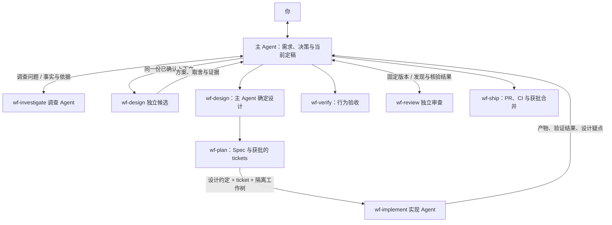

# Windflow

[English](README.md) | [简体中文](README.zh-CN.md)

**一组可以单独使用，也可以串起来完成开发的 Agent Skills。**

想读懂代码，用 `wf-investigate`；想比较设计，用 `wf-design`；想审查 PR，用 `wf-review`。需要从讨论一直推进到可合并的 PR 时，再用 `windflow` 编排完整流程。

```text
使用 wf-investigate，看看保存请求失败后会怎样重试，为什么这里需要幂等键。
使用 wf-review，审查这个 PR 是否会重复写入，先给出核验后的发现，不改代码。
使用 wf-write，把这份 README 改成第一次使用的人能照着操作的介绍。
```

## 安装你需要的 skills

```sh
npx skills@latest add YinFengWindy/windflow -g
```

安装时选择 skills 和你使用的 Agent。只装到当前项目时，去掉 `-g`。从本地目录安装时，把 `YinFengWindy/windflow` 换成 `.`。

只需要审查时，可以单独安装：

```sh
npx skills@latest add YinFengWindy/windflow --skill wf-review -g
```

阶段 skill 都带 `wf-` 前缀，避免和其他来源的同名 skill 冲突。如果你装过旧的无前缀版本（`review`、`plan` 等），先卸载，再安装 `wf-` 版本。

九个阶段 skill 都可以单独安装。只安装 `windflow` 入口不会带上其他 skill。宿主靠名称和描述发现 skill。当前阶段缺哪些 skill，由协调者的正文检查并报告，不靠安装器的元数据。

通过宿主的技能入口选择，或直接说“使用 wf-review”。安装需要 Node.js 和 npm。改代码和远程交付还需要 Git，以及仓库平台的访问权限。独立候选、并行实现和独立审查使用宿主的子 Agent。

## 选哪个 skill

| 你要做什么 | Skill | 会得到什么 |
| --- | --- | --- |
| 看懂当前代码和历史原因 | [wf-investigate](skills/wf-investigate/SKILL.md) | 行为链路、依据、约束和未知项。 |
| 把功能想清楚 | [wf-grill](skills/wf-grill/SKILL.md) | 经过讨论和确认的需求。 |
| 比较做法，再确定结构 | [wf-design](skills/wf-design/SKILL.md) | 候选方案比较，以及最终接口、类型和状态归属。 |
| 写 Spec 或拆任务 | [wf-plan](skills/wf-plan/SKILL.md) | 可验收的 Spec、tickets 和依赖关系。 |
| 实现明确的工作 | [wf-implement](skills/wf-implement/SKILL.md) | 代码改动和针对性检查结果。 |
| 验收已有结果 | [wf-verify](skills/wf-verify/SKILL.md) | 每项标准是否满足，以及证据和缺口。 |
| 找缺陷并核验建议 | [wf-review](skills/wf-review/SKILL.md) | 已确认缺陷、待核验问题和被排除的建议。 |
| 把已完成的改动交付 | [wf-ship](skills/wf-ship/SKILL.md) | PR、CI、获批合并和清理结果。 |
| 写清楚技术内容 | [wf-write](skills/wf-write/SKILL.md) | 适合读者任务的文档、说明或回复。 |
| 完整推进一个开发任务 | [windflow](skills/windflow/SKILL.md) | 上述阶段衔接起来的开发流程。 |

验收、审查和合并批准是三道不同的门，由 [windflow 协调者](skills/windflow/SKILL.md) 定义；每个阶段 skill 也会用一句话重述自己用到的那条，单独安装时同样成立。

## 一个完整任务会怎样推进

```text
使用 windflow，我想加离线编辑和自动同步。先看看现在的保存逻辑，再和我讨论冲突怎么处理。
```

1. **调查，再讨论。** 调查者读取保存入口、重试逻辑和历史记录。主 Agent 消化事实后，问你两台设备离线修改同一文档时该怎样处理冲突。新事实问题继续交给调查者。
2. **确认需求后设计。** `wf-design` 先让独立候选者提出方案，再由一直参与需求讨论的主 Agent 比较和确定接口、数据结构及状态归属。
3. **把方案拆成能验收的工作。** `wf-plan` 整理 Spec、检查相似 issue，并列出每个 ticket 的行为、验收条件和依赖。你确认拆分后才发布和实现。
4. **实现并验收。** 实现子 Agent 在隔离工作区修改代码。主 Agent 核对离线保存、恢复网络后的同步和已确认的冲突处理，复用有效的检查结果。
5. **审查，再交付。** 由独立审查者寻找失败路径，再逐条核验发现和修复必要性。完成后呈现实际 PR、CI 和剩余限制，请你决定是否合并。

只讨论、只规划、只做本地修改或只审查时，停在该结果。仍然适用的需求、设计和已有批准会继续沿用。

## Agent 怎样协作

主 Agent 保留当前约定，并和你沟通。工作者交回证据。交接规则在协调者的[协作说明](skills/windflow/references/coordination.md)。



## 审查建议也要核对

“以后可能会有人这样调用，所以加一层兜底”不能单独成为修改理由。一条发现要说明当前触发条件、失败机制，以及现有保护为什么挡不住。完整方法在 [wf-review](skills/wf-review/SKILL.md)，可以单独安装。

## 来源

| Windflow | 上游方法 |
| --- | --- |
| `wf-investigate` | pstack：`how`、`why` |
| `wf-grill` | Matt Pocock：`grilling` |
| `wf-design` | pstack：`arena`、`architect` |
| `wf-plan` | Matt Pocock：`to-spec`、`to-tickets` |
| `wf-write` | pstack：`unslop`、`technical-writing` |
| Agent 协作 | pstack：`swarm`；tt-a1i：`to-goal`、`spec-executor`（执行记录） |

参考 [Matt Pocock 的 skills](https://github.com/mattpocock/skills) 和 [Lauren Tan 的 pstack](https://github.com/cursor/plugins/tree/main/pstack)。修订、适配和第三方版权声明见 [THIRD_PARTY_NOTICES](THIRD_PARTY_NOTICES.md) 与 [版本锁定](upstream-lock.json)。

MIT。仓库许可证是 [LICENSE](LICENSE)。
